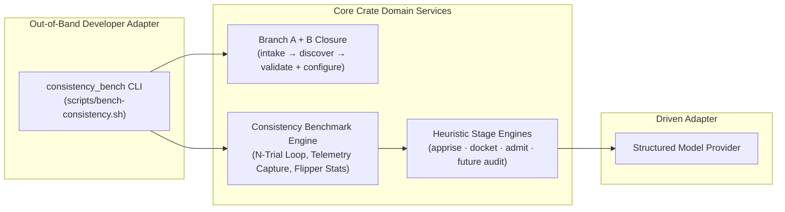
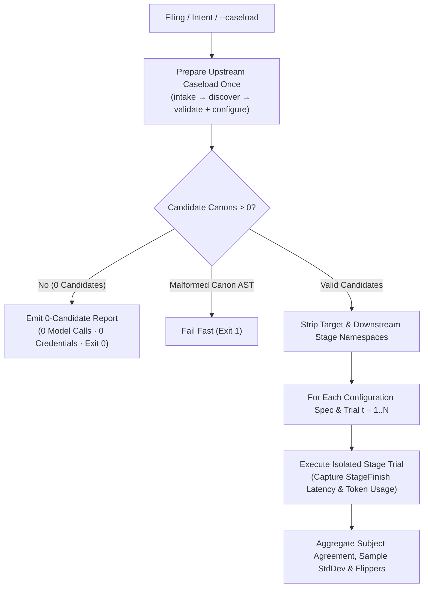

# Consistency & Flipper Benchmarking

**Status:** Authoritative Architectural Standard  
**Domain Concept:** Multi-Trial Heuristic Stability & Flipper Diagnostics

---

## 1. Executive Summary & Architectural Role

Static canon validation (`validate`) guarantees syntactic and structural conformance to `SPEC.md`, but cannot detect stochastic boundary instability when heuristic stages evaluate natural-language rules against realistic workloads. Across repeated evaluations ($N$ trials at `temperature: 0.0`), run-to-run classification variance (*flippers*) surfaces two distinct classes of defects:

1. **Engine & Prompt Drift:** Autoregressive score drift across large candidate canon sets, compliance-vs.-jurisdiction rubric confusion, or missing frontmatter context.
2. **Latent Canon-Authoring Ambiguity:** Non-atomic invariants, ambiguous grammatical subjects, unobservable cognitive conditions, or overly narrow terminology that place unrelated changes near the `0.5` decision boundary.

The **Consistency & Flipper Benchmark** domain service (`bench`) provides a repeatable, stage-polymorphic $N$-trial evaluation and statistical aggregation engine inside the core crate, paired with an out-of-band developer driving adapter (`scripts/bench-consistency.sh`).

### Stage Implementation Status

| Target Stage | Caseload Namespace | Subject Granularity | Live Trial Execution | Payload Extraction & Flipper Aggregation |
| :--- | :--- | :--- | :--- | :--- |
| **`apprise`** | `.apprisal` | 1D (`canon_path`) | Active | Active (`applicable` vs. `dismissed`) |
| **`docket`** | `.docket` | 1D (`canon_path`) | Active | Active (`docketed` vs. `dismissed`) |
| **`admit`** | `.evidence` | 2D `(canon_path, exhibit_path)` | Active | Active (`admitted` vs. `excluded`) |
| **`audit`** | `.verdict` | 1D (`canon_path`) | Deferred *(pending `audit` runner)* | Active (`pass` vs. `fail`) |

---

## 2. Hexagonal Boundary & Driving Adapter Separation

Canon Clerk preserves a strict boundary between the production review gate and developer benchmarking infrastructure:

- **Single-Verb Production CLI Invariant:** As established in [`overview.md`](overview.md#1-executive-summary-the-caseload-paradigm), subcommands on the shipped `canon-clerk` binary represent exclusively terminal stop points along the Caseload DAG (`intake`, `discover`, `validate`, `configure`, `probe`, `apprise`, `docket`, `admit`, `audit`). Multi-trial benchmarking is therefore exposed through a dedicated developer runner (`consistency_bench` / `scripts/bench-consistency.sh`) rather than adding non-DAG subcommands to `canon-clerk`.
- **Segregation from Hermetic Gates:** Executing live $N$-trial model sweeps requires network access, provider quotas, and API credentials. Keeping the benchmark runner separate from `./scripts/check.sh` guarantees that commit-stage and pull-request verification remain fast, offline, and deterministic, while still verifying all benchmark aggregation logic hermetically against mock providers during routine test suites.

---

## 3. Single-Closure Preparation & Trial Isolation Invariants

To measure model and rubric stability without confounding filing noise or redundant filesystem work, every benchmark run enforces three execution invariants:

1. **Shared Upstream Closure:** Deterministic Branch A (`intake` $\longrightarrow$ `discover` $\longrightarrow$ `validate`) and Branch B (`configure`) execute **once** prior to the trial loop. Consistent with the Guarded / Lazy Scheduling Invariant ([`scheduling.md`](scheduling.md#3-the-guarded--lazy-scheduling-invariant)), filings matching zero candidate canons complete cleanly with zero model calls and without requiring API credentials.
2. **Downstream Namespace Stripping:** Before executing each trial $t \in \{1, \dots, N\}$, the engine clears the target stage's namespace—and any downstream cascade namespaces—on the cloned upstream `Caseload` (e.g., clearing `.docket`, `.evidence`, and `.verdict` when benchmarking `docket`). This prevents fast-forward skip short-circuits even when the operator supplies a previously completed `caseload.json` via `--caseload`.
3. **Comparative Configuration Sweeps:** A single invocation may specify multiple batching configurations (such as unbounded single-turn alongside balanced batch sizes `15` and `25`). Every configuration in the sweep evaluates against the identical prepared upstream `Caseload` and workspace snapshot, isolating batch-partitioning and concurrency effects on flipper rates and wall-clock latency.

---

## 4. Polymorphic Subject Identity & Statistical Contracts

### 1D Canon Keys vs. 2D Exhibit Keys
Different Caseload stages assess different evidentiary units:
- **1D Canon Scope (`apprise`, `docket`, `audit`):** Each trial yields one score, derived status, and rationale summary per candidate or active canon (`canon_path`). The optional `exhibit_path` attribute is omitted from serialized JSON records.
- **2D Canon–Exhibit Scope (`admit`):** Micro evidentiary triage evaluates individual candidate exhibits per active case (`(canon_path, exhibit_path)`). Serialized subject records populate both `canon_path` and `exhibit_path`, and human-readable reports render the composite identifier as `<canon_path> :: <exhibit_path>`.

### Exhibit Assessment Extraction & Defensive Sparse Backfilling
In `admit` ([`nodes/admit.md`](nodes/admit.md#caseload-delta)), `.evidence.exhibits` records both `"admitted"` and `"excluded"` assessments with continuous `admissibility_score` values, preserving exact score distributions across trials. When benchmarking `admit` without a pre-populated `.docket`, the harness executes upstream `docket` once prior to the trial loop so all $N$ trials evaluate against an identical active docket. If any external or hand-crafted `Caseload` fixture omits excluded entries in a subset of trials, the aggregator computes the deterministic lexicographical union of observed `(canon_path, exhibit_path)` keys and backfills missing entries as `excluded` (`score: 0.0`).

### Statistical & Flipper Definitions
- **Flipper Classification (`is_flipper`):** A subject is classified as a **flipper** if and only if its deterministically derived stage status varies across the $N$ completed trials (equivalently, modal status agreement $< 100\%$).
- **Modal Agreement Rate (`agreement_rate`):** Fraction of trials sharing the subject's most frequent status in $(0.0, 1.0]$ (`1.0` for unanimous `5/5` subjects; `0.6` for a `3/5` vs. `2/5` split).
- **Score Sample Standard Deviation (`score_stdev`):** Unbiased sample standard deviation across the $N$ continuous trial scores:
  $$
  s = \sqrt{\frac{1}{N - 1} \sum_{t=1}^{N} (x_t - \bar{x})^2}
  $$
  returning `0.0` when $N \le 1$. Configuration summaries report both the arithmetic mean (`mean_score_stdev`) and maximum (`max_score_stdev`) across all subjects.
- **Operational Telemetry Accounting:** Each trial executes inside an isolated stage telemetry scope, capturing exact `StageFinish` wall-clock `duration_ms` (`min`, `median`, `mean`, `max` across trials) and multi-batch aggregated token usage (`prompt_tokens`, `completion_tokens`, `reasoning_tokens`, `total_tokens`).
- **Deterministic Ordering:** Subject collections and flipper breakdowns serialize in strict lexicographical order by `(canon_path, exhibit_path)`.

---

## 5. Developer Driving Adapter Contract

The `consistency_bench` CLI adapter (invoked via `./scripts/bench-consistency.sh`) adheres to all repository CLI ergonomics invariants:

- **Precedence Cascade:** Benchmark flags (`--stage`, `--trials`, `--threshold`, `--batch-size`, `--concurrency`, `--format`, `--include-stable`, `--output-json`) resolve with standard precedence: explicit CLI flags $\succ$ `CANON_CLERK_BENCH_*` environment variables $\succ$ stage-specific environment variables (`CANON_CLERK_APPRISE_*`, `CANON_CLERK_DOCKET_*`, `CANON_CLERK_ADMIT_*`) $\succ$ host `config.json` defaults $\succ$ built-in defaults (`N = 5` trials, threshold `0.5`, concurrency `4` when batched).
- **Data vs. Diagnostic Stream Separation:** Per-trial execution progress (`[bench] ...`) writes exclusively to `stderr` (suppressed via `-q` / `--quiet`), while `stdout` emits uncorrupted Markdown diagnostic tables or canonicalized benchmark report JSON (`--json` / `--format json`). `--output-json <path>` archives the structured JSON report to disk independently of `stdout` so operators can view Markdown tables interactively while saving machine-readable artifacts.
- **Standardized Exit Codes:**
  - **`0`:** Benchmark completed across all configured trials (including zero-candidate and empty-docket short-circuits or runs where flippers were observed—flipper presence is diagnostic data, not a process error).
  - **`1`:** Candidate canon failed static `validate` linting, or local runtime I/O error.
  - **`2`:** CLI usage error, invalid batch/trial/threshold specification, unsupported live stage (`audit` prior to runner implementation), missing credentials, or upstream provider failure.
