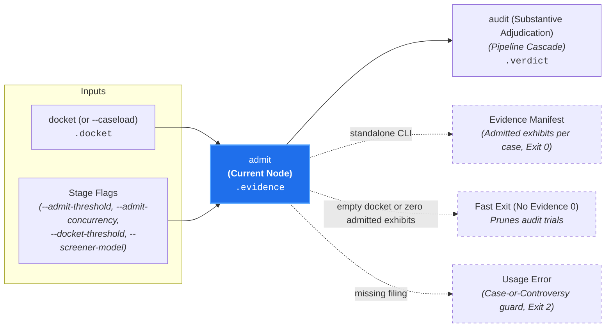

# Evidence Admissibility Triage (`admit`)

**Status:** Authoritative Architectural Standard  
**Core Domain Engine:** Caseload Domain Engine  
**Driving Adapter:** CLI (`admit`)

---

## 1. Domain Concept & Role (`core`)

`admit` performs **Micro Triage: Evidentiary Relevance Screening** for each active Case on the docket. In the court clerkship taxonomy, it represents the clerk reviewing tendered documents, affidavits, and physical exhibits to formally admit only relevant evidence into the case record prior to trial.

- **Imperative Verb:** `admit`
- **Court Clerkship Role:** Micro triage establishing evidentiary admissibility.
- **Metric Pair:** `admissibility_score` (number [0.0, 1.0]) and `admissibility_summary` (string rationale).
- **Core Question:** *"For an active Case, is this candidate exhibit (file modification, target file snapshot, or inspected pull request metadata plane) admissible as relevant evidence?"*

---

## 2. Dependencies & Prerequisites (`core`)



- **Direct Prerequisites:**
  - `docket` (active macro triage docket in `caseload.docket.active_docket`).
  - `configure` (Branch B: resolved provider credentials and model specifiers in `caseload.config`, evaluated JIT only when active cases with candidate exhibits exist).
- **Transitive Prerequisites:** `intake`, `discover`, `validate`.
- **The Case or Controversy Invariant:** Like `docket`, `admit` evaluates the admissibility of concrete filing exhibits *as applied to an active case*. It strictly requires an underlying filing (`caseload.intake` populated from target paths, `-`, `--diff`, `--all-targets`, PR metadata, or an incoming `--caseload`). Naked invocations or canon-only invocations lacking a concrete filing (e.g. `canon-clerk admit --all-canons` without targets or diff) fail fast with exit code `2`.
- **Pruned from Execution:** `probe`, `apprise`, downstream substantive adjudication (`audit`).

---

## 3. Caseload Contribution & Data Plane Constraints

### Caseload Delta
`admit` populates the `.evidence` namespace on the cumulative `Caseload` envelope with micro evidentiary relevance assessments across all docketed cases:

- **Per-Case Exhibit Assessments (`exhibits`):** A deterministic map keyed by active canon identifier (`canon_path`). Each active case maps to a stably sorted list of exhibit assessments (`file_path`, `admissibility_summary`, continuous `admissibility_score` in `[0.0, 1.0]`, and deterministically derived `admissibility_status` of `"admitted"` when `admissibility_score >= threshold` or `"excluded"` when below threshold). Here `file_path` identifies either a repository-relative POSIX file path or an inspected filing metadata plane (`"pr_title"`, `"pr_body"`, `"linked_issues"`, `"commit_messages"`).
- **Trial-Ready Active Cases (`active_cases`):** Stably sorted list of canon identifiers from `.docket.active_docket` that retain at least one `"admitted"` exhibit after threshold gating, establishing the exact cases that proceed to substantive `audit` trials.
- **Diagnostic Anomalies (`anomalies`):** Optional manifest recording any non-fatal evidentiary screening anomalies encountered during micro triage (omitted when empty).

### Data Plane & Domain Short-Circuit Invariants
1. **Auditability with Strict Admitted-Only Trial Isolation:** Preserving `"excluded"` assessments alongside `"admitted"` assessments in `.evidence.exhibits` provides complete provenance in `caseload.json`, `--format compact`, and multi-trial consistency benchmarks without lossy score truncation. Downstream `audit` trials consume exclusively the admitted-only exhibit projection (`admissibility_status == "admitted"`), structurally guaranteeing that excluded exhibits never enter deep auditor prompts.
2. **Unified File & Metadata-Plane Screening vs. Grounding References:** `admit` screens contested filing exhibits—both candidate file exhibits (unified diff patches or materialized workspace target files within the canon's monorepo `<scope>/`) and present `inspect:` metadata planes (`pr_title`, `pr_body`, `linked_issues`, `commit_messages`). Static repository `references:` declared in canon frontmatter are authoritative statutory context injected during `audit`, not contested filing exhibits screened for exclusion.
3. **Completion-Order-Independent Deterministic Folding:** Concurrent per-case screening calls fold into a lexicographically ordered `exhibits` map (with each case's exhibit list sorted lexicographically by `file_path`) and stably sorted `active_cases`, yielding byte-for-byte identical `.evidence` envelopes regardless of in-flight call completion order.
4. **Empty-Docket Short-Circuit:** If `.docket.active_docket` is empty (either from upstream macro dismissal or a pre-populated `--caseload`), `admit` attaches an empty `.evidence` record (`exhibits: {}`, `active_cases: []`) and exits `0` immediately with zero model calls and without requiring provider credentials when `.docket` was pre-populated.
5. **Zero-Evidence Short-Circuit:** If every case on `.docket.active_docket` retains zero admitted exhibits (`active_cases` is empty), the engine attaches the populated `.evidence` record and halts downstream cascade execution immediately with exit code `0`, scheduling zero substantive `audit` trials.

---

## 4. Process & Domain Logic (`core`)

1. **Prerequisite Verification & Empty-Docket Early Exit:**  
   Verifies that `.intake`, `.discovery`, and `.docket` are present and that static canon validation succeeded (`.validation.has_errors` is `false`). If `.docket.active_docket` is empty, attaches an empty `.evidence` record and returns immediately with zero model calls.
2. **Candidate Exhibit Resolution per Active Case:**  
   For each canon on `.docket.active_docket`, resolves its stably sorted candidate exhibits:
   - In standard triggered discovery, candidate exhibits come directly from `.discovery.triggers_join[canon_path]` (unifying matched file paths and active `inspect:` metadata planes).
   - In plenary `--all-canons` discovery (where trigger matching was bypassed), candidate exhibits resolve from in-scope `.discovery.target_files` (when the canon inspects `diff`) unioned with present filing metadata planes declared in the canon's `inspect:` frontmatter.
   - Candidate file exhibits present unified diff patches from `.intake.diffs` when available, or materialized UTF-8 file snapshots from the workspace when evaluating target-path or `--all-targets` sweeps.
3. **Concurrent Per-Case Screening (`gemini-flash-lite-latest`):**  
   Evaluates each active case in an **independent, isolated prompt turn** using `caseload.config.screener_model` at `temperature: 0.0` (with extended thinking omitted so `gemini-flash-lite-latest` executes with zero thinking tokens):
   - Executes active case calls concurrently up to the configured concurrency ceiling (`--admit-concurrency` / `--max-concurrent-calls`, default `4`), summing token accounting and thought events across all case calls into `StageFinish` telemetry. If any case call fails provider transport or schema validation, the stage fails fast.
4. **Constrained Decoding Schema (Domain-Indirected, Reason-First):**  
   Enforces a constant-size structured JSON wire array pairing each `file_path` (file path or metadata plane identifier) with `admissibility_summary` generated before `admissibility_score`:
   ```json
   {
     "exhibits": [
       {
         "file_path": "pr_title",
         "admissibility_summary": "Conventional Commit `feat(cli):` prefix is irrelevant to kebab-case flag naming.",
         "admissibility_score": 0.12
       },
       {
         "file_path": "src/cli/docket/mod.rs",
         "admissibility_summary": "Defines new `--docket-threshold` CLI flag governed by kebab-case naming rules.",
         "admissibility_score": 0.95
       }
     ]
   }
   ```
   Generating `admissibility_summary` before `admissibility_score` provides a chain-of-thought scratchpad anchoring reproducible probability distributions. Every candidate exhibit for the case must appear once without unknown or duplicate identifiers.
5. **Anchored Evidentiary Rubric & Omission Awareness (`admissibility_score >= --admit-threshold`, default: `0.5`):**  
   Screener system instructions anchor scores to discrete relevance bands (`0.75 - 0.95` for relevant evidence vs. `0.05 - 0.25` for orthogonal boilerplate), separating **evidentiary relevance** from **substantive compliance** (compliant code touching the governed construct is still relevant evidence and must be admitted). For canons requiring companion updates or metadata (such as `feat` pull requests required to update `README.md` or link motivating issues), exhibits evidencing the triggering change (`pr_title`, `pr_body`, or modified feature files) are scored admissible even when the required companion file is absent from the diff. The domain engine then deterministically derives `admissibility_status`:
   - Exhibits scoring $\ge 0.5$ are marked `"admitted"`.
   - Exhibits scoring $< 0.5$ are marked `"excluded"`.
   - Cases retaining $\ge 1$ admitted exhibit enter `active_cases`; cases with zero admitted exhibits are dismissed without trial.

---

## 5. Driving Adapter: CLI

The CLI exposes `admit` as an imperative subcommand:

```bash
# 1. Run telescoping pipeline stopping at admit from a unified diff on stdin:
git diff origin/main | canon-clerk admit --diff -

# 2. Screen explicit target paths or newline-delimited stdin paths:
canon-clerk admit src/cli src/docket
git diff origin/main --name-only | canon-clerk admit -

# 3. Execute micro evidentiary triage against an upstream Caseload:
canon-clerk admit --caseload caseload-5.json --json

# 4. Emit tab-separated compact exhibit assessments for shell scripting:
git diff origin/main | canon-clerk admit --diff - --format compact
```

### Missing Input Source & Case-or-Controversy Guard
`canon-clerk admit` requires an underlying filing (positional `TARGETS`, newline-delimited target paths via `-`, `--diff <PATH|->`, `--all-targets`, pull request metadata flags, or an incoming `--caseload <PATH|->` with `.intake` populated). Naked invocations or canon-only invocations lacking a concrete filing (e.g. `canon-clerk admit --all-canons` without target paths or diff, or an abstract corpus-only `--caseload` without `.intake`) fail fast with exit code `2` (Usage Error) and print actionable remediation guidance:
```text
error: No filing source provided for `admit`.
  Hint: Pipe a diff via standard input ('--diff -'), specify target paths ('src/...', '-', '--all-targets'),
        or pass an upstream caseload ('--caseload <PATH|->') with '.intake' populated.
```
Conversely, when an explicitly designated stream yields zero changes, `discover` matches zero candidate canons, or `docket` opens zero colorable cases, the pipeline short-circuits cleanly with exit code `0`.

### CLI Flags & Environment
- `TARGETS` / `-` (Positional): Target file paths, directories, globs, or `-` to read newline-delimited target paths from standard input.
- `--diff <PATH|->`, `--all-targets`, `--intent <TEXT>`, `--pr-title <TEXT>`, `--pr-body <TEXT>`, `--pr-body-file <PATH>`: Shared filing source and metadata flags.
- `--all-canons`, `--canon <PATH|GLOB>`: Shared canon selection scope flags (evaluated against the underlying filing).
- `--admit-threshold <FLOAT>` (fallback env: `CANON_CLERK_ADMIT_THRESHOLD`): Evidentiary admissibility threshold in `[0.0, 1.0]` (default: `0.5`). Ambiguous unqualified `--threshold` and out-of-closure `--apprise-threshold` (along with `--apprise-batch-size` and `--apprise-concurrency`) are rejected with exit code `2` and guidance pointing to `--admit-threshold` and `--docket-threshold`.
- `--admit-concurrency <COUNT>` / `--max-concurrent-calls <COUNT>` (fallback env: `CANON_CLERK_ADMIT_CONCURRENCY` / `CANON_CLERK_MAX_CONCURRENT_CALLS`; config file key: `admitConcurrency`): Optional positive integer (`>= 1`) bounding the maximum concurrent in-flight per-case screener calls (default: `4`). Follows standard precedence (explicit CLI flag $\to$ environment variable $\to$ `~/.config/canon-clerk/config.json` $\to$ built-in default).
- `--docket-threshold <FLOAT>` (`CANON_CLERK_DOCKET_THRESHOLD`), `--docket-batch-size <COUNT>` / `--max-canons-per-call <COUNT>` (`CANON_CLERK_DOCKET_BATCH_SIZE`), `--docket-concurrency <COUNT>` (`CANON_CLERK_DOCKET_CONCURRENCY`): Upstream macro jurisdiction triage options accepted transitively for telescoping runs.
- `--screener-model <MODEL>` (`CANON_CLERK_SCREENER_MODEL`), `--auditor-model <MODEL>` (`CANON_CLERK_AUDITOR_MODEL`), `--reasoning-budget <TOKENS>` (`CANON_CLERK_REASONING_BUDGET`), `--gemini-api-key <KEY>` (`GEMINI_API_KEY`): Shared model configuration and credential options (resolved JIT only when heuristic screening is required).
- `-v` / `--verbose` (`CANON_CLERK_VERBOSE`), `--log-file <PATH>` (`CANON_CLERK_LOG_FILE`): Global diagnostic progress and structured JSONL telemetry stream options.
- `--format <stylish|json|compact>`: Output presentation format (default: `stylish`).
- `--caseload <PATH|->`: Ingests upstream `Caseload` JSON from file or `-` for standard input.
- `--output-caseload <PATH>`: Writes cumulative `Caseload` JSON to disk independently of terminal `stdout`.
- `--json`: Emits enriched `Caseload` JSON to `stdout` (equivalent to `--format json`).

### CLI Output Modes
- **`stylish` (Default):** Renders the 6-stage **Pipeline Funnel Provenance Receipt** (`intake` $\to$ `discover` $\to$ `validate` $\to$ `configure` $\to$ `docket` $\to$ `admit`) followed by the Evidence Manifest listing active cases (`active_cases`) and their admitted exhibits alongside `admissibility_summary` rationales (including explicit watermarks on empty dockets or zero admitted exhibits).
- **`compact`:** Emits unadorned tab-separated `<canon>\t<exhibit>\t<status>\t<score>\t<summary>` records in deterministic lexicographical order by `(canon_path, file_path)`.
- **`json` / `--json`:** Emits the cumulative `Caseload` JSON envelope containing the populated `.evidence` container.

### CLI Exit Codes
- **0:** Candidate exhibits screened and `.evidence` attached (including clean zero-change, zero-candidate, empty-docket, and zero-admitted-exhibits short-circuits).
- **1:** Candidate canon validation failure (`validation.has_errors` is `true`, evaluated before checking `GEMINI_API_KEY`) or local workspace I/O runtime error.
- **2:** Usage error, missing filing source or Case-or-Controversy guard violation, invalid or out-of-range `--admit-threshold` / `--docket-threshold`, invalid or zero `--admit-concurrency` / `--docket-batch-size` / `--docket-concurrency`, rejected `--threshold` or `--apprise-*` flag, conflicting `stdin` operands, missing API credentials, or model provider error.
