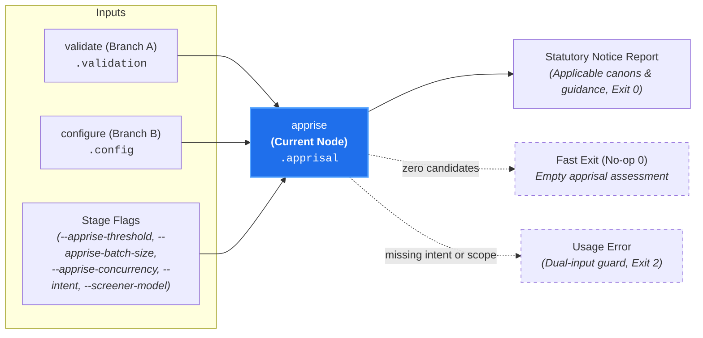

# Statutory Apprisal (`apprise`)

**Status:** Authoritative Architectural Standard  
**Core Domain Engine:** Caseload Domain Engine  
**Driving Adapter:** CLI (`apprise`)

---

## 1. Domain Concept & Role (`core`)

`apprise` performs **Prospective Jurisprudential Screening: Statutory Apprisal for Design-Time Guidance** across all candidate canons matching the prospective target scope.

In the court clerkship taxonomy, `apprise` represents the court exercising its **Apprisal Authority** (*Jurisdictio Notificatoria*). Rather than functioning as a trial judge hearing evidence on past infractions (the contentious `audit` path), `apprise` acts as the **Clerk of the Court apprising parties of governing rules**. It receives a prospective design inquiry—formulated as planned file targets and design intent—and determines which canons claim subject-matter jurisdiction over the planned work, providing contributors and AI coding agents with pre-flight notice of governing statutes before implementation begins.

- **Imperative Verb:** `apprise`
- **Court Clerkship Role:** Statutory apprisal, procedural notice, and jurisdictional applicability determination.
- **Metric Pair:** `apprisal_score` (number [0.0, 1.0]) and `apprisal_summary` (string rationale justifying prospective jurisdiction).
- **Core Question:** *"Given this prospective design intent and target scope, does this canon have a colorable claim of jurisdiction over the planned work?"*

---

## 2. Dependencies & Prerequisites (`core`)



- **Direct Prerequisites:**
  - `validate` (Branch A: validated candidate canons in `caseload.discovery.candidate_canons` and `caseload.validation`).
  - `configure` (Branch B: resolved provider credentials and model specifiers in `caseload.config`).
- **Transitive Prerequisites:** `intake`, `discover`.
- **The Dual-Input Invariant:** Statutory apprisal evaluates governing statutes against **both** a non-empty prospective design `intent` (`--intent <text>` or pre-populated `.intake.intent`) **and** an explicit target or canon scope (`TARGETS`, `-`, `--diff`, `--all-targets`, `--all-canons`, `--canon`, or pre-populated upstream `.discovery`). Omitting either input fails fast with exit code `2` rather than silently evaluating an empty scope.
- **Branch Independence & Pruning:**
  - Evaluates without requiring code diffs, patches, or work-in-progress (WIP) exhibits.
  - Decoupled from the contentious dispute track: completely prunes `docket`, `admit`, and `audit` from execution.
  - Diagnostic leaf `probe` is never scheduled.

---

## 3. Caseload Contribution & Data Plane Constraints

### Caseload Delta
`apprise` populates the `.apprisal` namespace on the cumulative `Caseload` envelope with prospective statutory notice records:

- **Per-Canon Apprisal Assessments (`assessments`):** A deterministic map keyed by candidate canon identifier. Each assessment captures the model's `apprisal_summary` (rationale explaining why the canon does or does not govern the planned design intent and target scope), continuous `apprisal_score` in `[0.0, 1.0]`, and deterministically derived `apprisal_status` (`"applicable"` when `apprisal_score >= threshold`, otherwise `"dismissed"`).

### Data Plane & Domain Short-Circuit Invariants
1. **Deterministic Status Derivation:** The screener model emits only `apprisal_summary` and `apprisal_score`; the domain engine deterministically evaluates the score against `--apprise-threshold` (default `0.5`) to assign `apprisal_status` (`"applicable"` vs. `"dismissed"`).
2. **Completion-Order-Independent Deterministic Folding:** Whether candidate canons are evaluated in a single aggregate call or partitioned into concurrent batches, all per-canon assessments fold into a deterministic lexicographically ordered `assessments` map. Identical per-canon model outputs produce byte-for-byte identical `.apprisal` records regardless of batch partitioning or in-flight batch completion order.
3. **Empty Candidate Short-Circuit:** If `.discovery.candidate_canons` is empty, the engine attaches an empty `.apprisal` record (`assessments: {}`) and terminates immediately with exit code `0`, dispatching zero model calls.

---

## 4. Process & Domain Logic (`core`)

1. **Dual-Input Verification & Candidate Canon Early Exit:**  
   Verifies that non-empty prospective design intent is present on `caseload.intake.intent` alongside resolved discovery scope in `caseload.discovery`. Extracts `candidate_canons` from `caseload.discovery` (resolved from prospective target paths, globs, or explicit canon selection). If `candidate_canons` is empty after evaluating an explicit target or canon scope, attaches an empty `.apprisal` record (`assessments: {}`) and short-circuits immediately with exit code `0`.
2. **Dual-Mode Aggregate & Batched Canon Screening (`google:*` Generative vs. `typesafe:*` Discriminative):**  
   Evaluates candidate canons against the prospective design intent and target scope context using `caseload.config.screener_model`:
   - **Generative Structured Screening (`google:*`, e.g., `gemini-flash-lite-latest`):** Evaluates at `temperature: 0.0` (with extended thinking omitted so `gemini-flash-lite-latest` executes with zero thinking tokens), screening all candidate canons in a single aggregate prompt turn by default or partitioning into balanced contiguous batches (`div_ceil`) when `--apprise-batch-size` / `--max-canons-per-call` is configured.
   - **Discriminative `Noul` Screening (`typesafe:*`, e.g., `jev-latest`):** Encodes the prospective design intent and target scope once as shared filing context and evaluates parallel per-canon applicability hypotheses (`nouls`) in a single forward pass with zero output tokens, surfacing deterministic statutory invariant notices on applicable canons while automatically partitioning oversized candidate sweeps into context-budgeted batches.
   - **Normalized Canon Grounding:** Each candidate canon renders normalized frontmatter metadata (`Triggers`, `Exists`, `Inspect` with trailing `?` on optional planes, `References`, `Tags`) when non-empty alongside matched `- Triggered Exhibits:`, the statute body, and canonical candidate identifiers (supporting local `.canons/...`, `builtin:...`, and `<pack>:...` references).
   - **Bounded In-Flight Concurrency & Telemetry Aggregation:** Executes batches concurrently up to the configured maximum concurrent in-flight calls (`--apprise-concurrency` / `--max-concurrent-calls`, default `4` when batched), deterministically merging per-batch assessments into `.apprisal.assessments` regardless of completion order and summing multi-batch token accounting and thought events into `StageFinish` telemetry. If any batch fails provider transport or schema validation, the stage fails fast.
3. **Constrained Decoding Schema (Domain-Indirected, Reason-First):**  
   Enforces a constant-size structured JSON wire array pairing each `canon_path` with `apprisal_summary` generated before `apprisal_score`:
   ```json
   {
     "assessments": [
       {
         "canon_path": ".canons/auth/cacheing-layers-must-have-configurable-expiry.md",
         "apprisal_summary": "Proposed round-robin dispatch introduces a dynamically updated provider cache, which must define explicit expiration policies.",
         "apprisal_score": 0.92
       },
       {
         "canon_path": ".canons/auth/database-migrations-must-include-rollback-instructions.md",
         "apprisal_summary": "The planned refactor only modifies in-memory provider dispatch and does not alter database schemas or migrations.",
         "apprisal_score": 0.05
       }
     ]
   }
   ```
   Generating `apprisal_summary` before `apprisal_score` provides a chain-of-thought scratchpad, anchoring reproducible probability distributions, while domain-indirected array items keep the wire grammar independent of candidate canon count. Each candidate canon must appear once without unknown or duplicate identifiers before folding into `.apprisal.assessments`.
4. **Anchored Rubric Calibration & Deterministic Threshold Gating (`apprisal_score >= --apprise-threshold`, default: `0.5`):**  
   Screener system instructions anchor scores to discrete prospective jurisdiction rubric bands—distinguishing direct or substantial engagement with the governed construct (`0.75 - 0.95`) from absent or orthogonal domain constructs (`0.05 - 0.25`) so borderline candidates do not wobble across the `0.5` boundary. The core domain engine then deterministically evaluates the continuous score against the threshold to assign `apprisal_status`:
   - Canons scoring $\ge 0.5$ establish prospective jurisdiction and are marked `apprisal_status: "applicable"`.
   - Canons scoring $< 0.5$ are marked `apprisal_status: "dismissed"`.
5. **Latency & Token Economy:** Executes in ~400ms on compact candidate sets (expending ~1,200 tokens across 20+ candidate canons), and scales across 40+ candidate canons via concurrent batches with reduced wall-clock latency and stabilized per-canon classifications.

---

## 5. Driving Adapter: CLI

The CLI exposes `apprise` as the primary entry point for design-time and pre-flight planning:

```bash
# 1. Inline design intent with prospective target paths:
canon-clerk apprise --intent "Refactor authentication to round-robin between providers" "src/auth" "src/frontend"

# 2. Streaming newline-delimited prospective target paths via standard input ('-'):
git diff origin/main --name-only | canon-clerk apprise --intent "Rotate auth provider" -

# 3. Running against an upstream Caseload file:
canon-clerk apprise --caseload upstream-discovery.json

# 4. Tab-separated compact records for shell scripting:
canon-clerk apprise --intent "Add CLI output flag" src/cli --format compact

# 5. Machine-readable JSON output for AI Agent prompt injection:
canon-clerk apprise --intent "Add Kafka event bus" src/events --json

# 6. Partition large candidate sets into concurrent batches of 15 canons:
canon-clerk apprise --intent "Add CLI output flag" src/cli --apprise-batch-size 15 --apprise-concurrency 4
```

### Dual-Input Guard (Missing Intent or Target Scope)
`canon-clerk apprise` enforces a strict **Dual-Input Guard**: invoking `apprise` requires **both** a non-empty prospective design `intent` (`--intent <TEXT>` or pre-populated `.intake.intent`) **and** an explicit target or canon scope (positional `TARGETS`, newline-delimited target paths via `-`, `--diff`, `--all-targets`, `--all-canons`, `--canon`, or pre-populated upstream `.discovery`). Omitting either input (naked invocation, supplying `--intent` without target/canon scope, or supplying target/canon scope without `--intent`) fails fast with exit code `2` (Usage Error) and prints actionable remediation guidance:
```text
error: Prospective apprisal requires both a non-empty design intent and an explicit target or canon scope.
  Hint: Pass '--intent <TEXT>' alongside target paths ('src/...', '-', '--diff <PATH|->', '--all-targets')
        or canon scope ('--all-canons', '--canon <PATH|GLOB>'), or supply '--caseload <PATH|->'.
```

Conversely, when both prospective design intent and an explicit target or canon scope are provided and `discover` matches zero candidate canons, the command attaches an empty `.apprisal` record (`assessments: {}`) and short-circuits cleanly with exit code `0` without invoking `validate` or requiring provider credentials (`GEMINI_API_KEY`).

### CLI Flags & Environment
- `TARGETS` / `-` (Positional): Prospective target file paths, directories, globs, or `-` to read newline-delimited target paths from standard input.
- `--intent <TEXT>`: Inline prospective architectural design intent or plan description.
- `--diff <PATH|->`, `--all-targets`, `--pr-title <TEXT>`, `--pr-body <TEXT>`, `--pr-body-file <PATH>`: Shared filing source and metadata flags.
- `--all-canons`, `--canon <PATH|GLOB>`: Shared canon selection scope flags.
- `--apprise-threshold <FLOAT>` (fallback env: `CANON_CLERK_APPRISE_THRESHOLD`): Prospective applicability threshold in `[0.0, 1.0]` (default: `0.5`). Ambiguous unqualified `--threshold` and out-of-closure stage threshold flags are rejected with exit code `2` and guidance pointing to `--apprise-threshold`.
- `--apprise-batch-size <COUNT>` / `--max-canons-per-call <COUNT>` (fallback env: `CANON_CLERK_APPRISE_BATCH_SIZE` / `CANON_CLERK_MAX_CANONS_PER_CALL`; config file key: `appriseBatchSize`): Optional positive integer (`>= 1`) capping the maximum candidate canons evaluated per screener model call. Follows standard precedence (explicit CLI flag $\to$ environment variable $\to$ `~/.config/canon-clerk/config.json` $\to$ unbounded single-call default).
- `--apprise-concurrency <COUNT>` / `--max-concurrent-calls <COUNT>` (fallback env: `CANON_CLERK_APPRISE_CONCURRENCY` / `CANON_CLERK_MAX_CONCURRENT_CALLS`; config file key: `appriseConcurrency`): Optional positive integer (`>= 1`) bounding the maximum concurrent in-flight screener model calls when candidate canons are partitioned into multiple batches (default: `4`). Follows standard precedence (explicit CLI flag $\to$ environment variable $\to$ `~/.config/canon-clerk/config.json` $\to$ built-in default).
- `--screener-model <MODEL>` (fallback env: `CANON_CLERK_SCREENER_MODEL`), `--auditor-model <MODEL>` (fallback env: `CANON_CLERK_AUDITOR_MODEL`), `--reasoning-budget <TOKENS>` (fallback env: `CANON_CLERK_REASONING_BUDGET`), `--gemini-api-key <KEY>` (fallback env: `GEMINI_API_KEY`), `--typesafe-api-key <KEY>` (fallback env: `TYPESAFE_API_KEY`): Shared model configuration and credential options (resolved JIT only when validated candidate canons exist).
- `-v` / `--verbose` (fallback env: `CANON_CLERK_VERBOSE`), `--log-file <PATH>` (fallback env: `CANON_CLERK_LOG_FILE`): Global diagnostic progress and structured JSONL telemetry stream options.
- `--format <stylish|json|compact>`: Output presentation format (default: `stylish`).
- `--caseload <PATH|->`: Ingests upstream `Caseload` JSON from file or `-` for standard input.
- `--output-caseload <PATH>`: Writes cumulative `Caseload` JSON to disk independently of terminal `stdout`.
- `--json`: Emits enriched `Caseload` JSON to `stdout` (equivalent to `--format json`).

### CLI Output Modes
- **`stylish` (Default):** Renders the **Pipeline Funnel Provenance Receipt** followed by the Statutory Apprisal summary listing applicable canons alongside their `apprisal_summary` rationales.
- **`compact`:** Emits unadorned tab-separated `<canon>\t<status>\t<score>\t<summary>` records (one candidate canon per line in deterministic lexicographical order).
- **`json` / `--json`:** Emits the cumulative `Caseload` JSON envelope containing the populated `.apprisal` container.

### CLI Exit Codes
- **0:** Successful statutory apprisal (including clean zero-candidate short-circuits).
- **1:** Candidate canon validation failure (`validation.has_errors` is `true`, evaluated before checking `GEMINI_API_KEY`) or local workspace I/O runtime error.
- **2:** Usage error, dual-input guard violation (missing design intent or missing target/canon scope), invalid or out-of-range `--apprise-threshold` / `CANON_CLERK_APPRISE_THRESHOLD`, invalid or zero `--apprise-batch-size` / `--apprise-concurrency` (or their environment/config fallbacks), rejected `--threshold` / `--docket-threshold` / `--admit-threshold` flag, conflicting `stdin` operands, missing API credentials, or model provider error.

