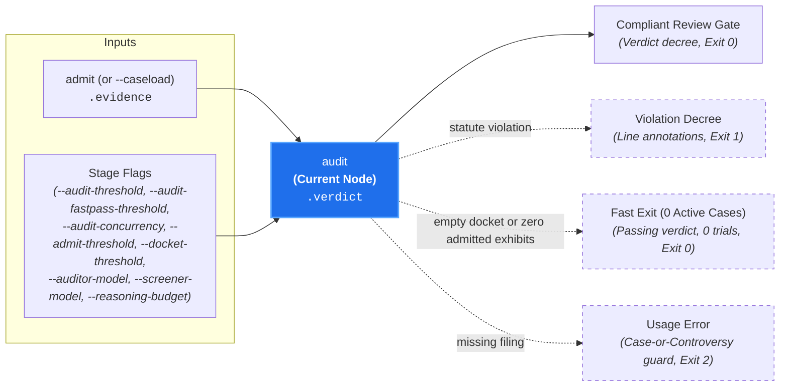

# Judicial Adjudication (`audit`)

**Status:** Authoritative Architectural Standard  
**Core Domain Engine:** Caseload Domain Engine  
**Driving Adapter:** CLI (`audit`)

---

## 1. Domain Concept & Role (`core`)

`audit` performs **Substantive Adjudication: Merits Evaluation & Verdict Generation** for all active cases retaining admissible evidence. In the court clerkship taxonomy, it represents the Judge taking the bench, hearing arguments strictly on the admitted exhibits, evaluating affirmative defenses (`Exception`), and rendering formal decrees with actionable remediation.

- **Imperative Verb:** `audit`
- **Court Clerkship Role:** Judicial trial and decree rendering.
- **Metric Pair:** `compliance_score` (number [0.0, 1.0]) and `compliance_summary` (string decree).
- **Core Question:** *"Given the admitted exhibits, statutory grounding references, and governing invariant/exceptions, does the evidence comply with canon statute?"*

---

## 2. Dependencies & Prerequisites (`core`)



- **Direct Prerequisites:**
  - `admit` (admitted exhibits and trial-ready active cases in `caseload.evidence`).
  - `configure` (Branch B: resolved provider credentials, auditor model specifier, and optional reasoning budget in `caseload.config`, evaluated JIT only when heuristic screening or trial adjudication is required).
- **Transitive Prerequisites:** `intake`, `discover`, `validate`, `docket`.
- **The Case or Controversy Invariant:** Like `docket` and `admit`, `audit` adjudicates compliance *as applied to a concrete filing*. It strictly requires an underlying filing (`caseload.intake` populated from target paths, `-`, `--diff`, `--all-targets`, PR metadata, or an incoming `--caseload`). Naked invocations or canon-only invocations lacking a concrete filing (e.g. `canon-clerk audit --all-canons` without targets or diff) fail fast with exit code `2`.
- **Pruned from Execution:** `probe`, `apprise`.

---

## 3. Caseload Contribution & Data Plane Constraints

### Caseload Delta
`audit` populates the `.verdict` namespace on the cumulative `Caseload` envelope with the final judicial decree and per-case trial outcomes:

- **Overall Gate Verdict (`status` & `summary`):** Top-level review gate `status` (`"pass"` when all adjudicated cases pass or zero trials were required, or `"fail"` if any case fails) accompanied by a deterministically synthesized human-readable `summary`.
- **Per-Case Substantive Adjudications (`adjudications`):** Stably ordered list of trial decrees, one per adjudicated case (`canon_path`) from `.evidence.active_cases`. Each record captures the model's `compliance_summary` (substantive decree explaining compliance, matched exceptions, or required remediation), continuous `compliance_score` in `[0.0, 1.0]`, deterministically derived case `status` (`"pass"` when `compliance_score >= threshold`, else `"fail"`), and stably sorted line-level `annotations`.
- **Violation Line Annotations (`CodeAnnotation`):** Structured source locations (`path`, `start_line`, `end_line`, optional `start_column` and `end_column`, `annotation_level` of `"failure"`, `"warning"`, or `"notice"`, `message`, and optional `title`) pinpointing non-compliant code spans on admitted file exhibits.

### Data Plane & Adjudication Invariants
1. **Admitted-Only Zero-Leakage Trial Isolation & Statutory Reference Grounding:** `audit` schedules isolated trials strictly for `.evidence.active_cases` and consumes **exclusively** each case's `"admitted"` exhibits (unified diff patches or materialized workspace target files with 1-based line coordinates, plus admitted `inspect:` metadata planes such as `"pr_title"`, `"pr_body"`, and `"linked_issues"`). Excluded exhibits (`"excluded"`) never enter auditor prompts. Static workspace files matched by frontmatter `references:` (resolved relative to the canon's monorepo `<scope>/` when scoped) are injected alongside the canon statute as authoritative reference context.
2. **Three-Tier Determinism & Annotation-Anchoring Guardrails:**
   - **Engine & Wire Determinism:** Concurrent per-case trials fold into `.verdict.adjudications` in strict lexicographical order by `canon_path`, and each case's `annotations` sort deterministically by `(path, start_line, end_line, start_column, end_column, annotation_level, message)`, guaranteeing byte-for-byte reproducible serialization regardless of async completion order.
   - **Gate Verdict Stability:** The domain engine deterministically derives each case's `status` against `--audit-threshold` (default: `0.5`) and sets `.verdict.status` to `"fail"` if and only if at least one case has `status: "fail"`. Polarized score bands (`>= 0.80` vs. `<= 0.20`) anchor unanimous `pass`/`fail` stability across repeated trials.
   - **Bounded Guidance & Span Normalization:** While natural wording differences in `compliance_summary` or `message` and minor span granularity differences across live reasoning runs are expected and benign, all decoded annotations must obey strict structural invariants: `path` must match an admitted file exhibit for that case (never an un-touched or non-existent file), line coordinates are normalized to 1-based `start_line >= 1` and `end_line >= start_line`, file-level or missing-companion omission violations anchor to line `1` (`1..1`) of the primary triggering admitted file exhibit, and violations confined purely to admitted PR metadata planes (`pr_title`, `pr_body`, `linked_issues`) emit `annotations: []`.
3. **Empty-Evidence Short-Circuit:** If `.evidence.active_cases` is empty (either because upstream `docket` dismissed all canons, `admit` excluded all candidate exhibits, or an incoming `--caseload` carried zero active cases), `audit` attaches a passing `.verdict` (`status: "pass"`, `adjudications: []`) and exits `0` immediately with zero model calls and without requiring provider credentials when upstream `.docket` or `.evidence` was pre-populated empty.

---

## 4. Process & Domain Logic (`core`)

1. **Prerequisite Verification & Empty-Evidence Early Exit:**  
   Verifies that `.intake`, `.discovery`, and `.evidence` are present and that static canon validation succeeded (`.validation.has_errors` is `false`). If `.evidence.active_cases` is empty, attaches a clean passing `.verdict` (`adjudications: []`) and returns immediately with zero model calls.
2. **Admitted Exhibit & Statutory Reference Assembly:**  
   For each canon on `.evidence.active_cases`:
   - Projects strictly its `"admitted"` exhibits from `.evidence.exhibits[canon_path]`.
   - Formats admitted file exhibits with explicit 1-based target-file line coordinates (annotated unified diff hunks from `.intake.diffs` when present, or numbered UTF-8 file snapshots from the workspace for path-only / `--all-targets` sweeps) alongside admitted filing metadata blocks (`pr_title`, `pr_body`, `linked_issues`).
   - Resolves static frontmatter `references:` patterns within the canon's `<scope>/` against materialized workspace files and injects them as authoritative statutory reference context.
3. **Concurrent Isolated Per-Case Trials & Two-Tier Happy-Path Fast-Pass:**  
   Evaluates active cases up to `--audit-concurrency` (default: `4`), aggregating prompt, completion, reasoning, and total token usage alongside intermediate reasoning `Thought` deltas into `StageFinish` telemetry:
   - **Standard Generative Trials (`google:*`, e.g., `gemini-pro-latest`):** Evaluates each active case in an **independent, isolated prompt turn** at `temperature: 0.0`, forwarding `caseload.config.reasoning_budget` when configured so Canon A's exceptions and references never bleed into Canon B's trial.
   - **Two-Tier Discriminative Happy-Path Fast-Pass (`typesafe:*` Screener $\to$ `google:*` Auditor):** When `caseload.config.screener_model` targets a discriminative decision model (`typesafe:*`) and `caseload.config.auditor_model` targets a generative reasoning model (`google:*`), `audit` first evaluates each active case's admitted exhibits and statute via a single-forward-pass discriminative compliance `Noul` check (zero output tokens). Cases whose compliance probability meets `max(--audit-threshold, --audit-fastpass-threshold)` (default `0.80`) pass immediately, whereas any suspected violation or low-confidence borderline case (`score < fastpass_threshold`) automatically escalates to an isolated deep generative `auditor_model` trial to evaluate exceptions, synthesize remediation guidance, and anchor 1-based line `CodeAnnotation`s.
   - **Pure Discriminative Trials (`typesafe:*` Auditor):** When `caseload.config.auditor_model` itself targets a discriminative model, `audit` renders deterministic statute-grounded decrees directly from compliance probabilities (anchoring failing cases at line `1` of the primary admitted file exhibit when applicable).
4. **The Four-Step Judicial Decision Tree & Polarized Score Rubric:**
   - **Step 1 (Invariant Evaluation):** Evaluates admitted exhibits strictly against the normative invariant (What), treating `Rationale` (Why) as disambiguating intent context and `Remediation` (How) as post-violation repair guidance rather than extra syntactic mandates (`SPEC.md` §5). If compliant $\implies$ score in `[0.80, 1.0]`, `annotations: []`.
   - **Step 2 (Exception Screening):** If a prima facie violation is detected, evaluates declared `Exception` clauses against the admitted exhibits. If an exception's verifiable conditions are satisfied $\implies$ short-circuits to conditional `pass` (`compliance_score` in `[0.80, 0.95]`, `annotations: []`), citing the matched exception in `compliance_summary`.
   - **Step 3 (Remediation Formulation):** If no exception applies $\implies$ violation stands (`compliance_score` in `[0.0, 0.20]`), formulating concise, actionable contributor remediation (How) in `compliance_summary`.
   - **Step 4 (Line Annotations):** Emits 1-based file, line, and optional column coordinates on admitted file exhibits for each violation (anchoring file-level or missing-companion omission violations at line `1`, or emitting `[]` when the violation resides solely in PR metadata).
5. **Constrained Decoding Schema (Reason-First):**  
   Enforces a constant-size structured JSON schema generating `compliance_summary` before `compliance_score` and `annotations`:
   ```json
   {
     "compliance_summary": "The added command flags adhere strictly to kebab-case formatting.",
     "compliance_score": 0.96,
     "annotations": []
   }
   ```
   Generating `compliance_summary` before `compliance_score` provides a contrastive reasoning scratchpad anchoring stable probability distributions away from the `0.5` threshold. The domain engine validates annotation paths and line bounds, derives per-case `status` (`"pass"` when `compliance_score >= --audit-threshold`, else `"fail"`), and aggregates overall `.verdict.status`.

---

## 5. Driving Adapter: CLI

The CLI exposes `audit` as its flagship evaluation command:

```bash
# 1. Evaluate in-flight diff in telescoping mode:
git diff origin/main | canon-clerk audit --diff -

# 2. Audit explicit target paths or newline-delimited stdin paths:
canon-clerk audit src/cli src/admit
git diff origin/main --name-only | canon-clerk audit -

# 3. Adjudicate an admitted Caseload from an upstream pipeline stage:
canon-clerk audit --caseload caseload-6.json

# 4. Run in GitHub Actions mode while archiving the full Caseload JSON artifact:
git diff origin/main | canon-clerk audit --diff - --format github --output-caseload caseload.json

# 5. Use TypeSafe Jev for ultra-fast screening and happy-path fast-pass with Gemini Pro escalation:
git diff origin/main | canon-clerk audit --diff - --screener-model jev
```

### Missing Input Source & Case-or-Controversy Guard
`canon-clerk audit` requires an underlying filing (positional `TARGETS`, newline-delimited target paths via `-`, `--diff <PATH|->`, `--all-targets`, pull request metadata flags, or an incoming `--caseload <PATH|->` with `.intake` populated). Naked invocations or canon-only invocations lacking a concrete filing (e.g. `canon-clerk audit --all-canons` without target paths or diff, or an abstract corpus-only `--caseload` without `.intake`) fail fast with exit code `2` (Usage Error) and print actionable remediation guidance:
```text
error: No filing source provided for `audit`.
  Hint: Pipe a diff via standard input ('--diff -'), specify target paths ('src/...', '-', '--all-targets'),
        or pass an upstream caseload ('--caseload <PATH|->') with '.intake' populated.
```
Conversely, if an explicitly designated stream yields zero changes, `discover` matches zero candidate canons, `docket` opens zero colorable cases, or `admit` admits zero exhibits, the pipeline cleanly short-circuits with exit code `0`.

### CLI Flags & Environment
- `TARGETS` / `-` (Positional): Target file paths, directories, globs, or `-` to read newline-delimited target paths from standard input.
- `--diff <PATH|->`, `--all-targets`, `--intent <TEXT>`, `--pr-title <TEXT>`, `--pr-body <TEXT>`, `--pr-body-file <PATH>`: Shared filing source and metadata flags.
- `--all-canons`, `--canon <PATH|GLOB>`: Shared canon selection scope flags (evaluated against the underlying filing).
- `--audit-threshold <FLOAT>` (fallback env: `CANON_CLERK_AUDIT_THRESHOLD`): Substantive compliance threshold in `[0.0, 1.0]` (default: `0.5`). Ambiguous unqualified `--threshold` and out-of-closure `--apprise-*` flags (`--apprise-threshold`, `--apprise-batch-size`, `--apprise-concurrency`) are rejected with exit code `2` and guidance pointing to `--audit-threshold`, `--admit-threshold`, and `--docket-threshold`.
- `--audit-fastpass-threshold <FLOAT>` (fallback env: `CANON_CLERK_AUDIT_FASTPASS_THRESHOLD`): High-confidence discriminative fast-pass threshold in `[0.0, 1.0]` (default: `0.80`) governing when two-tier `audit` runs (`typesafe:*` screener + `google:*` auditor) accept a compliant case without escalating to a generative `auditor_model` trial. Accepted exclusively on `audit`.
- `--audit-concurrency <COUNT>` (fallback env: `CANON_CLERK_AUDIT_CONCURRENCY`; config file key: `auditConcurrency`): Optional positive integer (`>= 1`) bounding maximum concurrent in-flight per-case trial calls (default: `4`). Follows standard precedence (explicit CLI flag $\to$ environment variable $\to$ `~/.config/canon-clerk/config.json` $\to$ built-in default).
- `--admit-threshold <FLOAT>` (`CANON_CLERK_ADMIT_THRESHOLD`), `--admit-concurrency <COUNT>` / `--max-concurrent-calls <COUNT>` (`CANON_CLERK_ADMIT_CONCURRENCY`): Upstream micro evidentiary admissibility options accepted transitively for telescoping runs.
- `--docket-threshold <FLOAT>` (`CANON_CLERK_DOCKET_THRESHOLD`), `--docket-batch-size <COUNT>` / `--max-canons-per-call <COUNT>` (`CANON_CLERK_DOCKET_BATCH_SIZE`), `--docket-concurrency <COUNT>` (`CANON_CLERK_DOCKET_CONCURRENCY`): Upstream macro jurisdiction triage options accepted transitively for telescoping runs.
- `--auditor-model <MODEL>` (`CANON_CLERK_AUDITOR_MODEL`), `--screener-model <MODEL>` (`CANON_CLERK_SCREENER_MODEL`), `--reasoning-budget <TOKENS>` (`CANON_CLERK_REASONING_BUDGET`), `--gemini-api-key <KEY>` (`GEMINI_API_KEY`), `--typesafe-api-key <KEY>` (`TYPESAFE_API_KEY`): Shared model configuration and credential options (resolved JIT only when heuristic evaluation is required).
- `-v` / `--verbose` (`CANON_CLERK_VERBOSE`), `--log-file <PATH>` (`CANON_CLERK_LOG_FILE`): Global diagnostic progress and structured JSONL telemetry stream options.
- `--format <stylish|json|compact|github>`: Output formatting choice (defaults to `github` when `GITHUB_ACTIONS=true`, otherwise `stylish`).
- `--caseload <PATH|->`: Ingests upstream `Caseload` JSON from file or `-` for standard input.
- `--output-caseload <PATH>`: Writes cumulative `Caseload` JSON to disk independently of terminal `stdout` on both passing and failing runs (ideal for CI workflow artifact archiving with `if: always()`).
- `--json`: Emits enriched `Caseload` JSON to `stdout` (equivalent to `--format json`).

### CLI Output Modes & GitHub Actions Integration
- **`stylish` (Default Interactive):** Renders the complete 7-stage **Pipeline Funnel Provenance Receipt** (`intake` $\to$ `discover` $\to$ `validate` $\to$ `configure` $\to$ `docket` $\to$ `admit` $\to$ `audit`) followed by the Verdict summary (`PASS` / `FAIL`), per-case compliance decrees, and indented `CodeAnnotation` source diagnostics.
- **`compact`:** Emits deterministic tab-separated adjudication and diagnostic lines suitable for shell scripts and editor integrations.
- **`github` (CI Tripartite Output Model):** Auto-selected when `GITHUB_ACTIONS=true` (unless overridden by `--format` or `--json`):
  1. Emits native GitHub Actions workflow command annotations (`::error file=...,line=...,endLine=...,col=...,title=...::...`, `::warning ...`, `::notice ...`) for each `CodeAnnotation` on `stdout`.
  2. Appends the rendered Markdown Funnel Provenance Receipt and Verdict Report to `$GITHUB_STEP_SUMMARY` when configured.
  3. Persists the full cumulative `Caseload` JSON via `--output-caseload <PATH>` independently of exit status.
- **`json` / `--json`:** Emits the cumulative `Caseload` JSON envelope containing structured `.verdict` adjudications and annotations.

### CLI Exit Codes
- **0:** All evaluated cases pass (`status: "pass"`, `compliance_score >= --audit-threshold`), or 0 trials required due to clean upstream short-circuits (0 changes, 0 candidate canons, empty docket, or 0 admitted exhibits).
- **1:** Substantive canon violation detected (`.verdict.status == "fail"`), candidate canon static validation failure (`validation.has_errors` is `true`, evaluated before checking `GEMINI_API_KEY`), or local workspace I/O runtime error.
- **2:** Usage error, missing filing source or Case-or-Controversy guard violation, invalid or out-of-range threshold/concurrency/batch flags, rejected `--threshold` or `--apprise-*` flag, conflicting `stdin` operands, missing API credentials, or model provider error.
