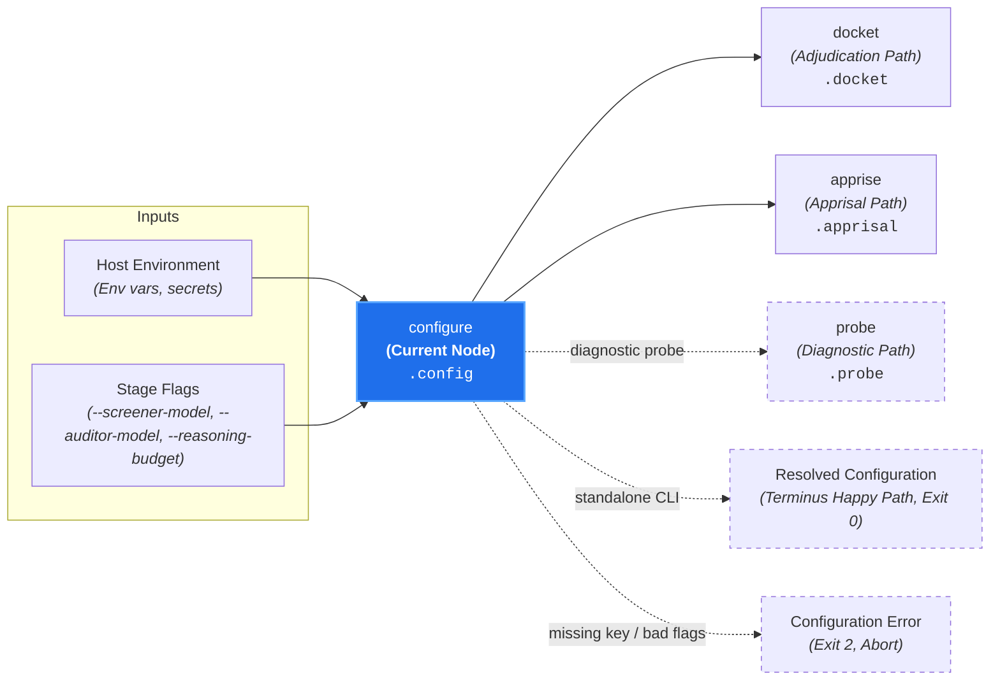

# Configuration & Environment (`configure`)

**Status:** Authoritative Architectural Standard  
**Core Domain Engine:** Caseload Domain Engine  
**Driving Adapter:** CLI (`configure`)

---

## 1. Domain Concept & Role (`core` / `configuration`)

`configure` serves as the **Operational Environment Normalizer** for Canon Clerk. In the court clerkship taxonomy, it represents the administrative court officer ensuring the courtroom facilities, judicial roster, and bailiff credentials are fully established before the court goes into session.

- **Imperative Verb:** `configure`
- **Court Clerkship Role:** Runtime environment resolution and provider credential validation.
- **Metric Pair:** N/A (Deterministic offline configuration resolution).

---

## 2. Dependencies & Prerequisites (`core`)



- **Direct Prerequisites:** None (Root node of Branch B).
- **Transitive Prerequisites:** None.
- **Independence:** Resolves environment credentials and models with zero dependencies on diffs or canons.
- **Lazy Evaluation in Cascades:** When executed within a review cascade (`docket`, `admit`, `audit`), `configure` is evaluated lazily *after* `discover` confirms matching candidate canons, guaranteeing that un-governed PRs pass cleanly without checking credentials.

---

## 3. Caseload Contribution & Data Plane Constraints

### Caseload Delta
`configure` populates the `.config` namespace on the cumulative `Caseload` envelope with normalized runtime provider settings:

- **Screener Model Specifier (`screener_model`):** Canonical provider-prefixed model identifier used by fast heuristic screening stages (`apprise`, `docket`, `admit`; defaults to `"google:gemini-flash-lite-latest"`).
- **Auditor Model Specifier (`auditor_model`):** Canonical provider-prefixed model identifier used for substantive trial adjudication (`audit`; defaults to `"google:gemini-pro-latest"`).
- **Reasoning Budget (`reasoning_budget`):** Optional token ceiling governing extended thinking during `audit` trials.

### Data Plane & Security Invariants
1. **Credential Non-Persistence & Zero Context Egress:** While `configure` verifies that required active-provider credentials (`GEMINI_API_KEY` / `providers.google.apiKey` and/or `TYPESAFE_API_KEY` / `providers.typesafe.apiKey`) are present, raw API keys and secret tokens are **never** serialized into `.config` on the `Caseload` envelope or echoed to terminal output, ensuring `caseload.json` artifacts and AI coding assistant tool traces remain safe from credential exfiltration.
2. **Workspace-External Credential Sourcing:** File-based configuration and credentials are sourced exclusively from user-level configuration directories outside the repository workspace envelope (`$XDG_CONFIG_HOME/canon-clerk/config.json` or `~/.config/canon-clerk/config.json` on Unix/macOS; `%APPDATA%\canon-clerk\config.json` on Windows). Any configuration file located inside the repository workspace is rejected with exit code `2` so workspace-scoped AI coding agents cannot read local secret files.
3. **POSIX Owner-Only Permission Enforcement:** On POSIX platforms, `configure` inspects file mode permissions before reading the user configuration file and fails fast with exit code `2` (suggesting `chmod 600`) if group or world permissions are granted (`(mode & 0o077) != 0`; only `0600` or `0400` are accepted).
4. **Canonical Multi-Provider Model Normalization:** Shorthand model aliases (`flash-lite`, `flash`, `pro` for Google Gemini; `jev` for TypeSafe Jev), unprefixed model identifiers (`gemini-*` $\implies$ `google:gemini-*`, `jev-*` $\implies$ `typesafe:jev-*`), and explicit `<provider>:<model>` specifiers (`google:*`, `typesafe:*`) are normalized into canonical provider-prefixed specifiers prior to being recorded on `.config`.

---

## 4. Process & Domain Logic (`configuration`)

1. **Hierarchical Precedence Cascade:** Resolves model specifiers, reasoning budgets, and provider credentials along a strict descending specificity cascade:
   - **Explicit CLI Flags:** `--screener-model`, `--auditor-model`, `--reasoning-budget`, `--gemini-api-key`, `--typesafe-api-key`
   - **Environment Variables:** `CANON_CLERK_SCREENER_MODEL`, `CANON_CLERK_AUDITOR_MODEL`, `CANON_CLERK_REASONING_BUDGET`, `GEMINI_API_KEY`, `TYPESAFE_API_KEY`
   - **User-Level Configuration File (`~/.config/canon-clerk/config.json`):** Organized into orthogonal `providers` authentication blocks (`providers.google.apiKey`, `providers.typesafe.apiKey`) and optional tier and concurrency defaults (`screenerModel`, `auditorModel`, `reasoningBudget`, `appriseBatchSize`, `appriseConcurrency`, `docketBatchSize`, `docketConcurrency`, `admitConcurrency`, `auditConcurrency`)
   - **Static Defaults:** `google:gemini-flash-lite-latest` (screener) and `google:gemini-pro-latest` (auditor)
2. **Model Specifier Normalization & Active-Provider Credential Gating:** Resolves shorthand aliases (`flash-lite` $\implies$ `google:gemini-flash-lite-latest`, `flash` $\implies$ `google:gemini-flash-latest`, `pro` $\implies$ `google:gemini-pro-latest`, `jev` / `typesafe:jev` $\implies$ `typesafe:jev-latest`) and rejects unsupported provider prefixes or malformed model identifiers *before* inspecting credentials. `configure` then verifies credentials strictly for the provider namespaces actively referenced by the resolved `screener_model` and `auditor_model` tiers—so pairing `typesafe:jev-latest` (screener) with `google:gemini-pro-latest` (auditor) requires both `TYPESAFE_API_KEY` and `GEMINI_API_KEY`, whereas homogeneous single-provider configurations require only that active provider's key.
3. **Deterministic & Offline:** Executes locally in <5ms without sending network requests or spending tokens.

---

## 5. Driving Adapter: CLI

The CLI exposes `configure` as an imperative subcommand:

```bash
# Normalize and print active configuration:
canon-clerk configure --json

# Override model tiers from flags (e.g., TypeSafe Jev screener + Gemini Pro auditor):
canon-clerk configure --screener-model jev --auditor-model pro
```

### CLI Flags & Environment
- `--screener-model <model>` (fallback env: `CANON_CLERK_SCREENER_MODEL`): Custom screener model specifier or alias (`flash-lite`, `flash`, `pro`, `jev`, `google:<model>`, `typesafe:<model>`).
- `--auditor-model <model>` (fallback env: `CANON_CLERK_AUDITOR_MODEL`): Custom auditor model specifier or alias.
- `--reasoning-budget <tokens>` (fallback env: `CANON_CLERK_REASONING_BUDGET`): Maximum reasoning budget tokens.
- `--gemini-api-key <key>` (fallback env: `GEMINI_API_KEY`): Google Gemini API key override.
- `--typesafe-api-key <key>` (fallback env: `TYPESAFE_API_KEY`): TypeSafe AI Jev API key override.
- `--format <stylish|json|compact>`: Output presentation format.
- `--caseload <path|->`: Ingests upstream Caseload.
- `--output-caseload <path>`: Writes cumulative `Caseload` JSON to disk independently of stdout.
- `--json`: Emits enriched Caseload JSON.

### CLI Exit Codes
- **0:** Configuration valid and normalized.
- **2:** Missing required active-provider credentials (`GEMINI_API_KEY` / `TYPESAFE_API_KEY`), insecure or workspace-resident configuration file, or invalid model/budget identifiers.
