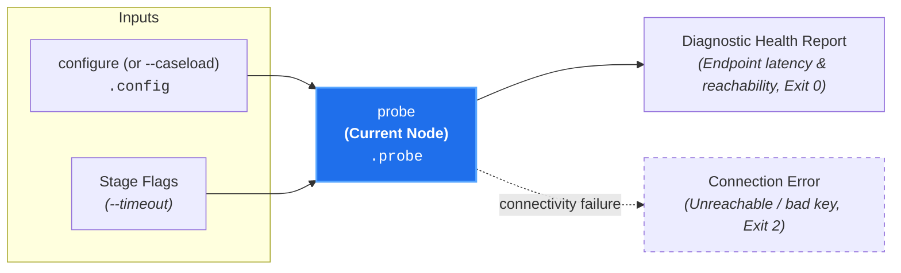

# Diagnostic Health Check (`probe`)

**Status:** Authoritative Architectural Standard  
**Core Domain Engine:** Caseload Domain Engine  
**Driving Adapter:** CLI (`probe`)

---

## 1. Domain Concept & Role (`core` / `configuration`)

`probe` serves as the **Diagnostic Network Health Check** for configured model endpoints. In the court clerkship taxonomy, it represents testing the teleconferencing equipment and audio-visual communication links before a remote hearing begins.

- **Imperative Verb:** `probe`
- **Court Clerkship Role:** Live connectivity and latency verification of provider endpoints.
- **Metric Pair:** N/A (Live connectivity probe; reports `status` and `latency_ms`).

---

## 2. Dependencies & Prerequisites (`core`)



- **Direct Prerequisites:** `configure` (requires resolved provider credentials and model specifiers in `caseload.config`).
- **Transitive Prerequisites:** None.
- **Pruned from Cascades:** `probe` is **never executed during review cascades** (`canon-clerk audit`). This ensures that evaluation runs do not incur redundant health-check latency prior to screening.

---

## 3. Caseload Contribution & Data Plane Constraints

### Caseload Delta
`probe` populates the `.probe` namespace on the cumulative `Caseload` envelope with live diagnostic health records for the configured model tiers:

- **Screener Endpoint Health (`screener`):** Connectivity probe result for `.config.screener_model`, capturing connection `status` (`"ok"` or `"error"`), roundtrip `latency_ms`, resolved `model` identifier, and an optional diagnostic `error` message when unreachable or unauthorized.
- **Auditor Endpoint Health (`auditor`):** Connectivity probe result for `.config.auditor_model` with the same diagnostic fields (`status`, `latency_ms`, `model`, and optional `error`).

### Data Plane & Diagnostic Invariants
1. **Cascade Isolation:** `.probe` is an auxiliary diagnostic leaf namespace; because `probe` is pruned from all evaluation cascades (`docket`, `admit`, `audit`, `apprise`), substantive review runs never populate or depend on `.probe`.
2. **Non-Throwing Diagnostic Capture:** Endpoint timeouts, HTTP 4xx/5xx responses, and authentication rejections are captured inside the respective endpoint health record (`status: "error"`, `error: "<reason>"`) on `.probe` before the CLI adapter maps any failure to exit code `2`.

---

## 4. Process & Domain Logic (`configuration`)

1. **Endpoint Resolution:** Reads configured `screener_model` and `auditor_model` from `caseload.config` and dispatches each tier to its corresponding provider endpoint adapter (`google:*` or `typesafe:*`).
2. **Provider-Native Ping Assembly:** Constructs minimal zero-reasoning probe requests—a single-token `:generateContent` ping for `google:*` endpoints and a minimal single-question `/v1/systemone` decision ping for `typesafe:*` endpoints—to verify authentication, model resolution, and network reachability.
3. **Concurrent Multi-Provider Probe:** Concurrently sends probe requests to both configured tiers in parallel:
   - Measures roundtrip response latency in milliseconds (`latency_ms`) and captures the concrete resolved model identifier returned by each provider.
   - Verifies model availability and provider credential validity across both homogeneous and mixed-provider tier pairings.
4. **Diagnostic Record:** Attaches endpoint latency and reachability metadata to `Caseload.probe`.

---

## 5. Driving Adapter: CLI

The CLI exposes `probe` as an imperative subcommand:

```bash
# Human-readable connectivity and latency check:
canon-clerk probe

# Probe TypeSafe Jev screener alongside Gemini Pro auditor:
canon-clerk probe --screener-model jev

# Emit structured JSON probe record:
canon-clerk probe --json
```

### CLI Flags & Options
- `--timeout <ms>`: Request timeout in milliseconds (default: `5000ms`).
- `--screener-model <model>` (fallback env: `CANON_CLERK_SCREENER_MODEL`): Custom screener model specifier or alias.
- `--auditor-model <model>` (fallback env: `CANON_CLERK_AUDITOR_MODEL`): Custom auditor model specifier or alias.
- `--reasoning-budget <tokens>` (fallback env: `CANON_CLERK_REASONING_BUDGET`): Maximum reasoning budget tokens.
- `--gemini-api-key <key>` (fallback env: `GEMINI_API_KEY`): Google Gemini API key override.
- `--typesafe-api-key <key>` (fallback env: `TYPESAFE_API_KEY`): TypeSafe AI Jev API key override.
- `--format <stylish|json|compact>`: Output presentation format.
- `--caseload <path|->`: Ingests upstream Caseload.
- `--output-caseload <path>`: Writes cumulative `Caseload` JSON to disk independently of stdout.
- `--json`: Emits enriched Caseload JSON.

### CLI Exit Codes
- **0:** All configured endpoints are reachable, authenticated, and responsive.
- **2:** Missing provider credentials, invalid configuration options, or any endpoint probe failed (authentication/permission rejection `401`/`403`, model not found `404`, quota/rate limit `429`, server error `5xx`, or request timeout).
