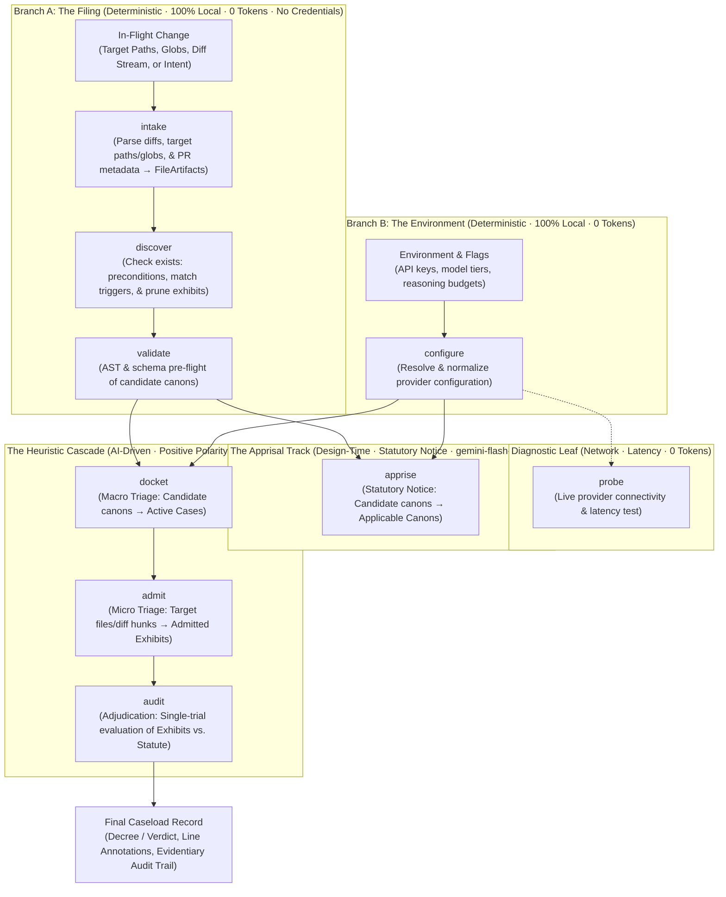
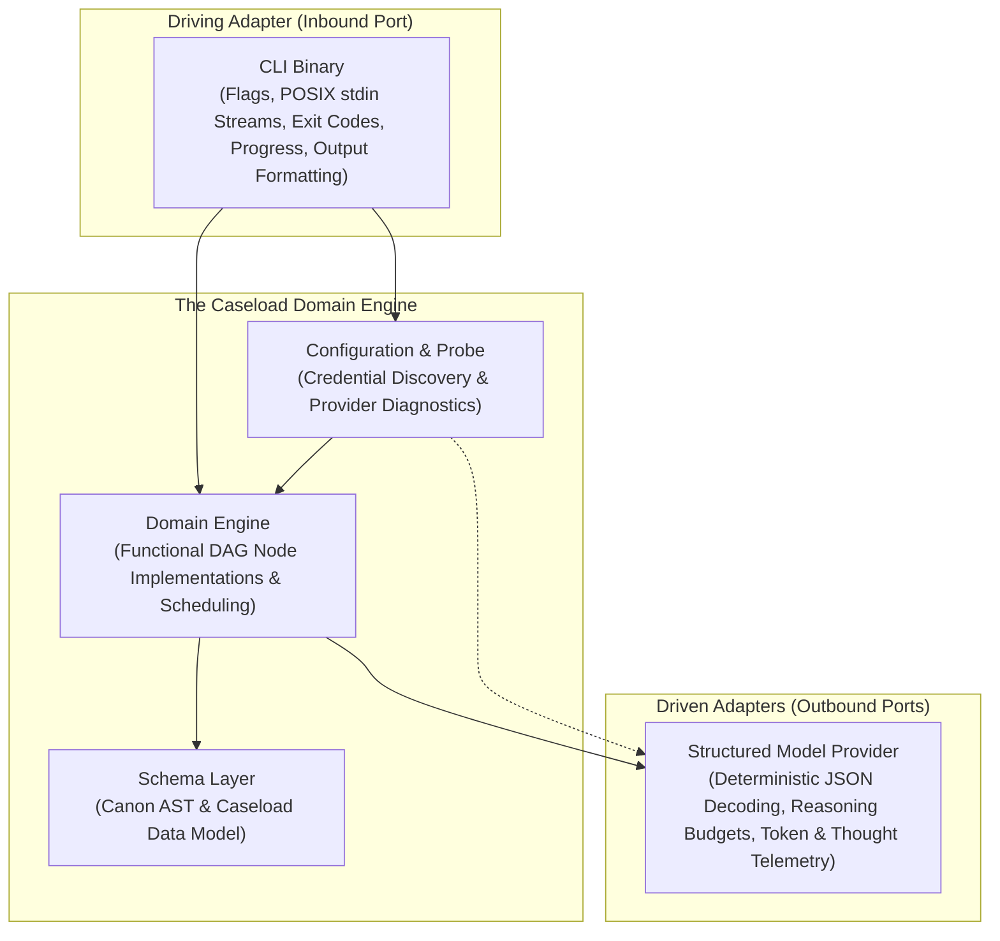
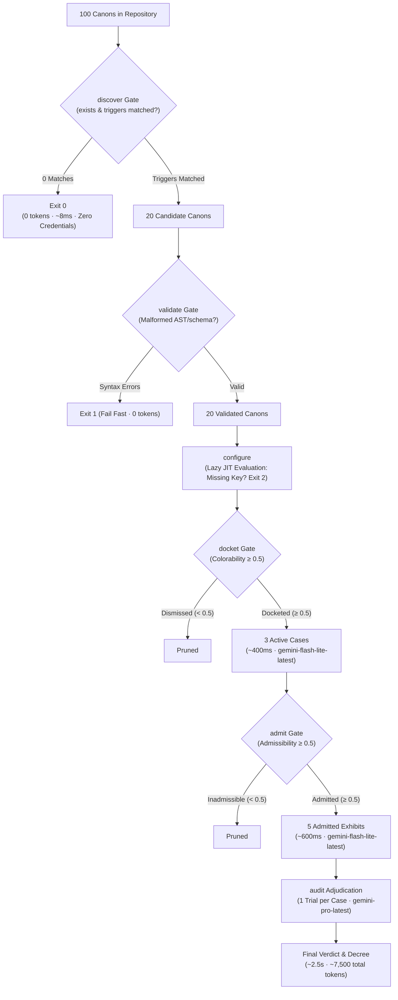

# The Caseload Pipeline: Architecture & Overview

**Status:** Authoritative Architectural Standard  
**Domain Concept:** The Caseload

---

## 1. Executive Summary: The Caseload Paradigm

Every evaluation in Canon Clerk begins with an in-flight change:
- Direct target file arguments (`canon-clerk audit packages/cli/src/app.ts`)
- Directory or file globs (`canon-clerk audit src/`, `canon-clerk audit '**/*.ts'`)
- Positional target paths streamed via stdin (`git diff origin/main --name-only | canon-clerk audit -`)
- A unified diff patch stream (`git diff origin/main | canon-clerk audit --diff -`)
- Pull request metadata (`--pr-title`, `--pr-body`) or structured payloads (`--gh-pr -`)

That in-flight change initiates a **`Caseload`**.

The `Caseload` is the central, cumulative state container flowing through a **Directed Acyclic Graph (DAG)** of functional stages. Rather than a collection of disjoint subcommands producing disparate outputs, Canon Clerk models the entire evaluation as a functional state machine where each stage enriches the shared `Caseload` record.

Subcommands serve as named **terminal stop points** along the DAG, formulated as crisp, single-word **imperative verbs**:

$$
\begin{aligned}
\text{Branch A (Filing Track):}\quad & \text{intake} \longrightarrow \text{discover} \longrightarrow \text{validate} \\
\text{Branch B (Environment Track):}\quad & \text{configure} \quad (\longrightarrow \text{probe}) \\
\text{Adjudication Spine:}\quad & \{\text{validate}, \text{configure}\} \longrightarrow \text{docket} \longrightarrow \text{admit} \longrightarrow \text{audit} \\
\text{Apprisal Track:}\quad & \{\text{validate}, \text{configure}\} \longrightarrow \text{apprise}
\end{aligned}
$$

When invoked, a subcommand executes only the **transitive dependency closure** required for its stage, pruning unneeded branches. Downstream commands fast-forward without re-running upstream stages when supplied an accumulated `Caseload` via `--caseload <path|->`.

---

## 2. DAG Topology: Two Feeder Branches $\to$ Adjudication Spine & Apprisal Track

The DAG consists of **Two Feeder Branches** that converge at `docket` (for dispute adjudication) and `apprise` (for prospective statutory notice), followed by the **Adjudication Spine**, with an auxiliary diagnostic leaf for provider health:

1. **Branch A: The Filing Track (`intake` $\longrightarrow$ `discover` $\longrightarrow$ `validate`):**  
   Ingests in-flight diffs, target paths, or prospective design intent, verifies state preconditions (`exists:`), matches candidate canon triggers, and validates candidate canon ASTs and schemas. Completely local, deterministic, and requires 0 tokens and zero API credentials.
2. **Branch B: The Environment Track (`configure`):**  
   Resolves provider credentials (`GEMINI_API_KEY`), model specifiers, and reasoning budgets. Completely offline, deterministic, and completes in <5ms with 0 tokens and zero network calls.
3. **Diagnostic Leaf (`probe`):**  
   An auxiliary termination node depending strictly on `configure`. Executes live provider connectivity and latency tests without triggering an audit run.
4. **The Heuristic Cascade (`docket` $\longrightarrow$ `admit` $\longrightarrow$ `audit`):**  
   Converges at `docket` (requiring both validated candidate canons and active provider configuration), followed by exhibit admissibility screening (`admit`) and single-trial adjudication (`audit`).
5. **The Prospective Apprisal Track (`apprise`):**  
   Converges at `apprise` (requiring validated candidate canons and provider configuration) to evaluate prospective design intent before implementation, completely bypassing diff parsing, `docket`, `admit`, and `audit`.



---

## 3. Hexagonal Architecture: The CLI Driving Adapter vs. Core Domain Processing

Canon Clerk strictly abides by **Hexagonal Architecture (Ports & Adapters)**. The DAG evaluation model is implemented as pure, environment-agnostic domain logic, decoupled from command-line arguments, operating system process boundaries, continuous integration environments, and external AI provider wire protocols.



### The Domain Engine (The Hexagon Core)
- **Schema Layer:** Defines the canonical representations for canons, frontmatter, ASTs, and the cumulative `Caseload` state container.
- **Evaluation Engine:** Houses pure implementations of all evaluation stages (`intake`, `discover`, `validate`, `docket`, `admit`, `audit`, `apprise`), DAG scheduling algorithms, prompt assembly, and constrained decoding schemas. It has no dependencies on CLI flags, stdout formatting, external environments, or vendor-specific HTTP payloads.
- **Configuration & Probe:** Resolves runtime environment and API credentials, normalizes model specifiers, and implements the diagnostic `probe` provider health check.

### The Driven Adapter (The Model Provider Boundary)
- **Provider-Neutral Structured Generation Port:** Encapsulates vendor-specific LLM transport protocols, REST wire types, and authentication headers behind a provider-agnostic port so heuristic stages (`apprise`, `docket`, `admit`, `audit`) evaluate exclusively against normalized model specifiers, system instructions, prompts, and JSON Schemas.
- **Deterministic Reason-First Constrained Decoding:** Enforces deterministic generation (`temperature: 0.0`) paired with strict JSON Schema output enforcement (`application/json`) so rationale scratchpad fields precede numeric scores across every heuristic call.
- **Extended Reasoning & Out-of-Band Telemetry Capture:** Maps optional token ceilings (`reasoning_budget`) to provider-native extended thinking controls, separates intermediate reasoning thought summaries from the decoded structured JSON payload, and captures prompt, completion, reasoning, and total token accounting alongside roundtrip latency for the out-of-band Telemetry Event Stream.
- **Credential Encapsulation & Actionable Error Classification:** Secret API keys are bound to concrete provider adapters at construction rather than carried on generation requests or `Caseload` envelopes, and upstream HTTP or transport failures (`401`/`403`, `404`, `429`, `5xx`, timeouts, safety blocks, or malformed JSON responses) are classified into actionable diagnostics with concrete remediation hints.

### The Driving Adapter (The CLI Boundary)
- **CLI Binary:** The sole driving adapter translating POSIX stdin streams (`-`, `--diff -`, `--caseload -`), argv flags, and local working directories into inputs for the domain engine and configuration. Formats user-facing terminal progress, spinners, event streams, and the **Pipeline Funnel Receipt** (summarizing upstream ancestor outcomes to prevent "silent zero" ambiguity), and maps domain results to shell exit codes (`0`, `1`, `2`).
- **CI / GitHub Integration (Tripartite Output Model):** CI runners invoke the native CLI binary directly without requiring a separate Action codebase. The CLI natively satisfies three output tiers in GitHub Actions:
  1. **Inline Diff Annotations:** Emits native workflow command annotations (`::error file=...::`, `::warning file=...::`) for all `CodeAnnotation`s on `stdout`/`stderr`, pinpointing line violations directly on the PR *Files changed* diff.
  2. **Run Summary:** Appends the rendered Markdown Funnel Receipt and stage verdict report to `$GITHUB_STEP_SUMMARY`.
  3. **Caseload Artifact Archival:** Supports `--output-caseload <path>` to write the full-fidelity cumulative `Caseload` JSON to disk independently of stdout. This allows workflows to upload `caseload.json` via `actions/upload-artifact` (`if: always()`) for post-run failure forensics, compliance auditing, or multi-job workflow chaining:
     ```yaml
     - name: Run Canon Clerk Gate
       run: |
         git diff origin/main | canon-clerk audit --diff - --output-caseload caseload.json

     - name: Archive Caseload Record
       if: always()
       uses: actions/upload-artifact@v4
       with:
         name: canon-clerk-caseload
         path: caseload.json
         retention-days: 14
     ```

---

## 4. The Architectural Triad: Colorability $\to$ Admissibility $\to$ Compliance

Grounding AI evaluation in the cognitive and procedural division of labor of a court clerkship establishes distinct, unambiguous semantics for every heuristic stage:

| Node / Imperative Verb | Core Concept | Metric Pair | Question Answered | Gate / Verdict Threshold |
| :--- | :--- | :--- | :--- | :--- |
| **`apprise`** | **Statutory Apprisal** *(Procedural Notice)* | `apprisal_score`<br/>`apprisal_summary` | *"Given this prospective design intent and target scope, does this canon have a colorable claim of jurisdiction over the planned work?"* | `score >= 0.5` $\implies$ Marked **Applicable** |
| **`docket`** | **Colorability** *(Subject-Matter Jurisdiction)* | `colorability_score`<br/>`colorability_summary` | *"Does this candidate canon have a colorable claim of jurisdiction over this PR as a whole?"* | `score >= 0.5` $\implies$ Opened as an **Active Case** |
| **`admit`** | **Admissibility** *(Relevance of Evidence)* | `admissibility_score`<br/>`admissibility_summary` | *"For an active Case, is this specific file/diff hunk admissible as relevant evidence?"* | `score >= 0.5` $\implies$ Admitted as an **Exhibit** |
| **`audit`** | **Compliance** *(Substantive Merits)* | `compliance_score`<br/>`compliance_summary` | *"Given the admitted exhibits and governing invariant/exceptions, does the change comply with canon statute?"* | `score >= 0.5` $\implies$ **Compliant** (`pass`) 🟢<br/>`score < 0.5` $\implies$ **Violation** (`fail`) 🔴 |

### The Court Clerkship Taxonomy
- **The Caseload:** The cumulative lifecycle container for the evaluation run.
- **Statutory Apprisal (`apprise`):** Procedural notice issued by the clerk apprising parties of governing statutes pertaining to prospective design intent before implementation begins.
- **Candidate Canons:** Rules whose declared `exists:` state preconditions match the Target File Tree, and whose `triggers:` or `inspect:` planes match in-flight exhibits during `discover` (subject to monorepo Scope Containment).
- **Cases:** Canons that pass macro triage during `docket` and enter the Active Docket.
- **Exhibits (The Unified Evidence Lifecycle):**
  - **Tendered Exhibits (`intake`):** Raw filing inputs, including literal text metadata (`pr_title`, `pr_body`, `commit_messages`, `linked_issues`), diff streams (`diff`), prospective design intent (`--intent`), and target file discovery directives.
  - **Candidate Exhibits (`discover`):** Materialized exhibits retained after mutual pruning with candidate canons (dropping un-inspected exhibits to preserve token hygiene).
  - **Admitted Exhibits (`admit`):** Exhibits formally admitted as relevant evidence for a specific Case on the docket (`admissibility_score >= 0.5`).
- **Trial / Decree:** The isolated prompt turn and final adjudication rendered during `audit` per Case against its admitted exhibits.

### Positive Polarity Consistency
All heuristic metrics share an identical polarity convention: **a higher score reflects the affirmative presence of the named property**:
- **`apprise` (High Apprisal):** Affirmative jurisdiction $\implies$ canon marked applicable (`score >= 0.5`).
- **`docket` (High Colorability):** Affirmative jurisdiction $\implies$ canon opened as an active Case.
- **`admit` (High Admissibility):** Affirmative relevance $\implies$ file/hunk admitted as an Exhibit for that Case.
- **`audit` (High Compliance):** Affirmative adherence $\implies$ change complies with canon statute and passes review (`score >= 0.5`).

---

## 5. The Caseload Pipeline Nodes

| Node / Verb | Track | Engine / Tier | Cost / Latency | Gate Rule |
| :--- | :--- | :--- | :--- | :--- |
| `intake` | Branch A (Filing) | Deterministic | 0 tokens, ~5ms | Parsed context; fail fast (code 2) on corrupted input |
| `discover` | Branch A (Filing) | Deterministic | 0 tokens, ~8ms | Matches > 0; verifies `exists:` & `triggers:`; short-circuits (exit 0) on 0 candidates |
| `validate` | Branch A (Filing) | Deterministic | 0 tokens, ~12ms | 0 syntax errors; fails fast (code 1) on lint error |
| `configure` | Branch B (Env) | Deterministic | 0 tokens, <5ms | Valid config; fails fast (code 2) on missing keys |
| `probe` | Diagnostic Leaf | Network probe | 0 tokens, variable | Endpoint reachable; fails fast (code 2) on failure |
| `apprise` | Apprisal Track | Flash-Lite AI | ~400ms, low $ | `apprisal_score >= 0.5`; exits 0 if candidates empty |
| `docket` | Cascade Spine | Flash-Lite AI | ~400ms, low $ | `colorability_score >= 0.5`; exits 0 if docket empty |
| `admit` | Cascade Spine | Flash-Lite AI | ~600ms, low $ | `admissibility_score >= 0.5`; exits 0 if no exhibits |
| `audit` | Cascade Spine | Pro Reasoning | ~2.5s, targeted | `compliance_score >= 0.5` $\implies$ pass (0), else fail (1) |

---

## 6. The Token & Latency Sieve

The Caseload Pipeline functions as an aggressive filter funnel, eliminating the overwhelming majority of candidate pairs before invoking deep reasoning:



| Pipeline Step | Canons / Cases in Flight | Target Exhibits | Model Tier | Token Cost | Latency |
| :--- | :--- | :--- | :--- | :--- | :--- |
| **Initial Workspace** | 100 canons | All repo files | Local AST / Globs | 0 tokens | ~25ms |
| **`discover` Gate** | 20 candidates | 6 touched files | Local Regex / Globs | 0 tokens | ~8ms |
| **`docket` Gate** | 3 active Cases | 6 touched files | `gemini-flash-lite-latest` | ~1,200 tokens | ~420ms |
| **`admit` Gate** | 3 active Cases | 5 admitted hunks | `gemini-flash-lite-latest` | ~1,800 tokens | ~610ms |
| **`audit` Adjudication** | 3 trials | 5 exhibits | `gemini-pro-latest` | ~4,500 tokens | ~2,400ms |
| **Total Funnel** | **3 evaluated** | **5 exhibits** | **Cascade Sieve** | **~7,500 tokens** | **< 3.5s** |

*(Versus naive evaluation: 100 canons × 6 files = 600 pairs $\approx$ 220,000 tokens and 45s latency. **~97% token reduction**).*

---

## 7. The Cumulative `Caseload` State Container

The `Caseload` is the central, immutable data envelope flowing through the pipeline. Rather than passing disjoint arguments between commands, each stage reads accumulated upstream state and enriches its own dedicated namespace on the shared `Caseload` object.

The formal Caseload domain models and granular payload schemas are specified in each node's architectural document.

### Top-Level Envelope Constraints

1. **Schema Versioning (`version`):** Every serialized `Caseload` envelope carries a top-level `version` identifier (currently `"1.0"`) establishing wire-format compatibility across piped CLI invocations and archived CI artifacts.
2. **Stage Namespace Isolation:** Each pipeline stage owns a dedicated, non-overlapping top-level optional namespace on the `Caseload` envelope (`.intake`, `.discovery`, `.validation`, `.config`, `.probe`, `.apprisal`, `.docket`, `.evidence`, `.verdict`). Unexecuted or pruned stages are omitted from serialized JSON rather than emitted as null placeholders.
3. **Additive Immutability:** Stages enrich only their designated namespace while preserving all pre-existing upstream namespaces bit-for-bit.
4. **Three-Tier Determinism & Stability Contract:**
   - **Engine & Wire Determinism (Bit-for-Bit):** All map keys, entity collections, per-case adjudications, and line annotations across stage payloads serialize in canonical lexicographical order so identical model responses, `--caseload` fast-forwards, and concurrent fold completion orders produce byte-for-byte identical JSON envelopes.
   - **Gate Verdict Stability (1D Flipper Contract):** Across repeated live runs at `temperature: 0.0`, heuristic stages anchor numeric scores to polarized bands away from the `0.5` decision boundary so per-canon gate classifications (`applicable`, `docketed`, `admitted`, `pass`/`fail`) remain unanimous even when extended reasoning trajectories vary.
   - **Guidance & Span Granularity (Benign Generative Variance):** Natural wording variations in rationale/remediation prose and minor line-span granularity shifts under extended reasoning are tolerated and never constitute verdict flippers, bounded by deterministic structural anchoring guardrails.

### Stage Payloads & Authoritative Specifications

Each pipeline stage owns a dedicated, non-overlapping field on the cumulative `Caseload`:

| Field on `Caseload` | Enriched By | Track | Payload Summary | Authoritative Specification |
| :--- | :--- | :--- | :--- | :--- |
| `.intake` | `intake` | Branch A (Filing) | Tendered exhibits: diff hunks, target paths, PR metadata, or intent queries | [`nodes/intake.md`](nodes/intake.md#caseload-delta) |
| `.discovery` | `discover` | Branch A (Filing) | Candidate canons matching path triggers & target file intersections | [`nodes/discover.md`](nodes/discover.md#caseload-delta) |
| `.validation` | `validate` | Branch A (Filing) | Deterministic AST linting and frontmatter schema validation results | [`nodes/validate.md`](nodes/validate.md#caseload-delta) |
| `.config` | `configure` | Branch B (Env) | Resolved screener/auditor model specifiers, reasoning budget, provider runtime options | [`nodes/configure.md`](nodes/configure.md#caseload-delta) |
| `.probe` | `probe` | Diagnostic Leaf | Live endpoint reachability, roundtrip latency (ms), and resolved models | [`nodes/probe.md`](nodes/probe.md#caseload-delta) |
| `.apprisal` | `apprise` | Apprisal Track | Prospective statutory jurisdiction assessments (`apprisal_score`, `apprisal_summary`) | [`nodes/apprise.md`](nodes/apprise.md#caseload-delta) |
| `.docket` | `docket` | Dispute Spine | Macro triage colorability assessments and list of opened active cases | [`nodes/docket.md`](nodes/docket.md#caseload-delta) |
| `.evidence` | `admit` | Dispute Spine | Micro triage evidence admissibility: admitted file exhibits per active case | [`nodes/admit.md`](nodes/admit.md#caseload-delta) |
| `.verdict` | `audit` | Dispute Spine | Final substantive adjudications, compliance scores, decrees, and line annotations | [`nodes/audit.md`](nodes/audit.md#caseload-delta) |

Downstream subcommands fast-forward across any stage whose corresponding namespace is already populated on an incoming `Caseload` (via `--caseload <path|->`).

---

## 8. Observability & The Telemetry Event Stream

Canon Clerk strictly separates **substantive evaluation records** from **operational execution telemetry**:

- **Substantive Record (`Caseload`):** Represents solely substantive findings, omitting wall-clock timestamps, token counters, and intermediate thought traces so serialized `caseload.json` envelopes remain free of operational telemetry churn across git diffs, cached artifacts, and hermetic snapshot tests.
- **Event Logging (`stderr` / `--log-file`):** Operational metrics (wall-clock milliseconds, token usage, time-to-first-token/thought) and streaming intermediate chunks (thought deltas) are emitted out-of-band via a structured **Telemetry Event Stream** comprising four lifecycle event categories:
  - **Stage Start (`StageStart`):** Signals entry into a `PipelineStage` along with an ISO-8601 `timestamp`.
  - **Reasoning Delta (`Thought`):** Streams incremental model reasoning `delta` chunks associated with an active `PipelineStage`.
  - **Stage Completion (`StageFinish`):** Records stage completion with elapsed wall-clock `duration_ms` and optional token `usage` metrics.
  - **Pipeline Completion (`PipelineFinish`):** Summarizes cumulative `total_duration_ms` and aggregate `total_tokens` across the completed DAG closure.
- **Executed-Stage Scoping:** Lifecycle events are emitted exclusively for pipeline stages that execute during the active invocation. Ancestor stages fast-forwarded from an incoming `--caseload` and downstream stages bypassed by deterministic short-circuit gates are omitted from the stream, and `PipelineFinish` aggregates `total_tokens` strictly across executed stages.
- **Structured Log Sink & Non-Interactive Hygiene:** Supplying `--log-file <path>` (or the `CANON_CLERK_LOG_FILE` environment variable) persists the structured event stream as newline-delimited JSON Lines (`JSONL`) on disk independently of terminal streams. Interactive or `--verbose` (`CANON_CLERK_VERBOSE`) CLI runs emit concise human-readable diagnostic progress exclusively to `stderr`, automatically disabling ANSI escape sequences and interactive decorations in non-TTY, `CI`, `NO_COLOR`, or quiet predicate environments so `stdout` payloads remain uncorrupted.
